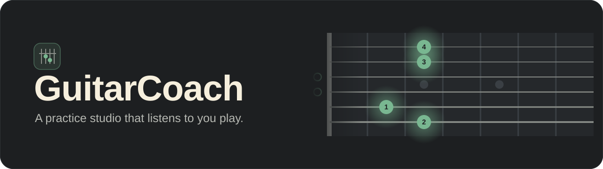
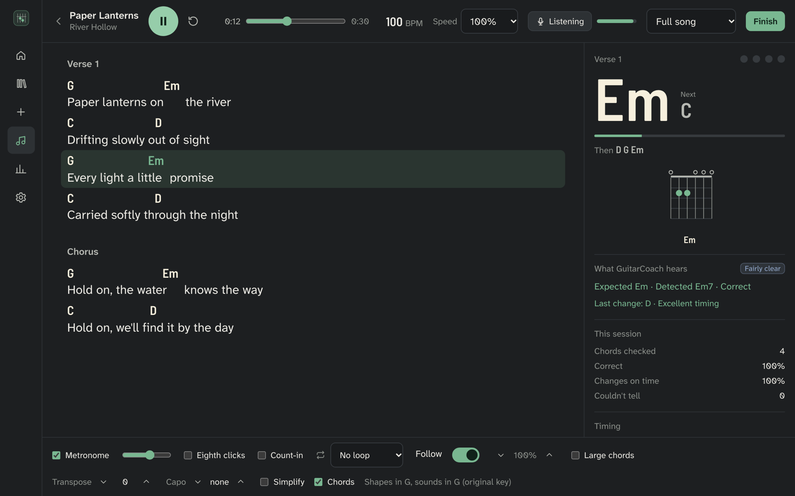
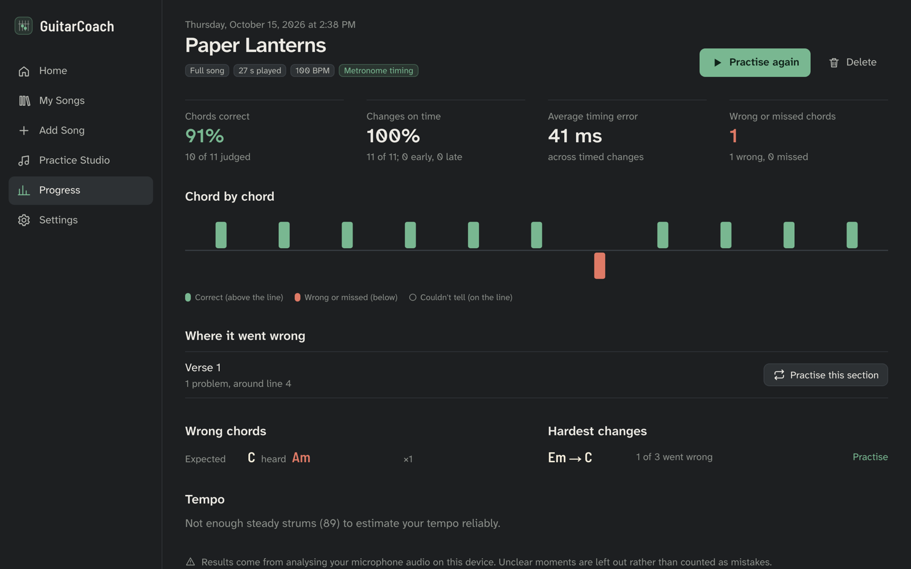
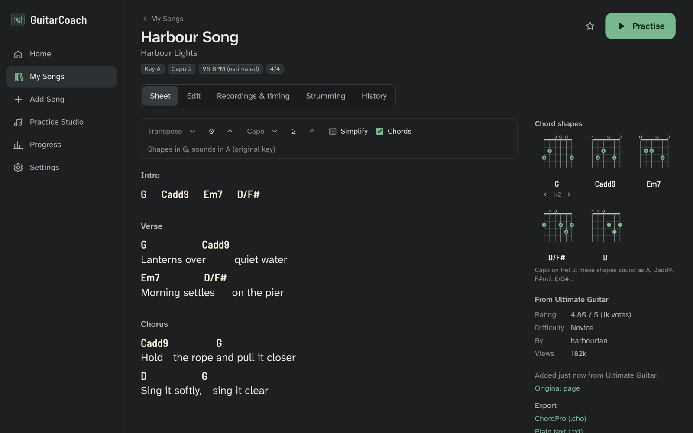
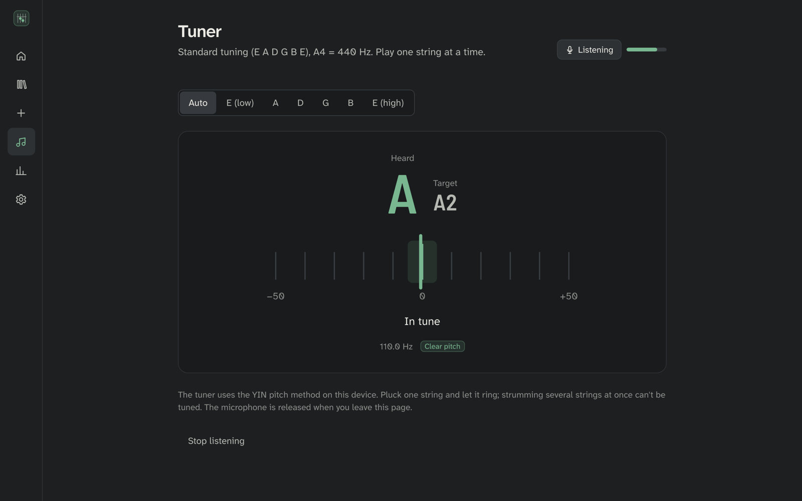
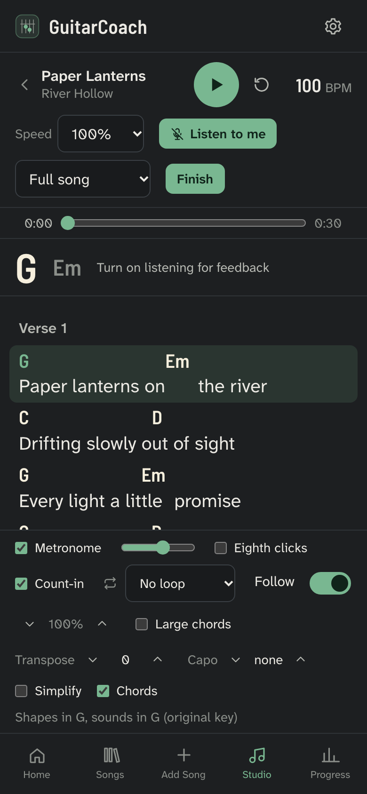
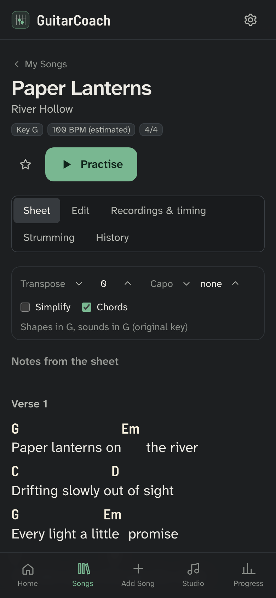
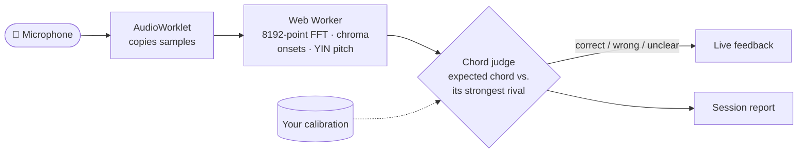

<p align="center">
  
</p>

<p align="center">
  <a href="https://theguitarcoach.vercel.app"><b>Open the app</b></a> &nbsp;·&nbsp;
  <a href="docs/user-guide.md">User guide</a> &nbsp;·&nbsp;
  <a href="docs/architecture.md">How it works</a> &nbsp;·&nbsp;
  <a href="docs/testing.md">Accuracy &amp; tests</a>
</p>

<p align="center">
  <a href="https://theguitarcoach.vercel.app"></a>
  
  
  
  
</p>

---

Most chord apps show you the chords and leave the rest to you. **GuitarCoach listens.** Bring in a song, press play, and strum along. It hears your guitar through the microphone and tells you which chords landed, which changes were late, and where to practise next. All the listening happens in your browser; your audio is never uploaded.

<p align="center">
  
</p>

## What it does

### Bring in any song
Paste an **Ultimate Guitar** link and you get the chords and lyrics plus everything the free page carries: strumming patterns (accents, palm mutes, triplets), every chord voicing with fingerings, key, capo, rating and the song's other versions. You can also paste a chord sheet, drop in a ChordPro file, PDF or photo (read on the device), import from any site with a bookmarklet, or start from a recording.

### Practise with a coach that listens
Play along with a metronome, your own recording (slowed down without changing pitch) or a **YouTube** video. The sheet scrolls with the music. Turn on **Listen to me** and every chord is checked as you play it, along with how close each change was to the beat. A 3-second get-ready countdown gives you time to pick up the guitar.

### See exactly what to fix
Every session ends with a report: chords correct, changes on time, timing error in milliseconds, which chord you played instead, and the transitions that trip you up, each with a button to practise it.

<table>
  <tr>
    <td width="50%"></td>
    <td width="50%"></td>
  </tr>
  <tr>
    <td><sub><b>Session report</b>: it caught the one bar where C was played as Am.</sub></td>
    <td><sub><b>Song page</b>: transpose, capo, simplify, voicings and the source's details.</sub></td>
  </tr>
</table>

### Tools for the fundamentals
| | |
| --- | --- |
| **Chord calibration** | Record a few takes and it learns how *your* guitar, strings, mic and room sound, with a before-and-after report. |
| **Chord changes** | One-minute changes between two chords: clean changes, average change time and consistency. |
| **Rhythm drill** | Strum a pattern to the click and see each strum early or late, plus tempo drift. |
| **Chord drill** | It names a chord; play it until it rings clearly. |
| **Tuner** | Standard tuning, cents and a confidence reading. |
| **Free play** | Shows the chord it hears, nothing else. |

<p align="center">
  
</p>

### Yours, on every device
It installs to your phone's home screen and works offline. Sign in with Google or email to sync songs, recordings, history and calibration between your laptop and phone.

<p align="center">
  
  &nbsp;&nbsp;&nbsp;
  
</p>

## How the listening works



A chord is only called **wrong** when a clearly different chord fits the sound better. Anything ambiguous is reported as unclear and left out of your score, so noise never counts against you. More in [How it works](docs/architecture.md).

## How accurate is it?

Tested on **[GuitarSet](https://zenodo.org/records/3371780)**: 180 real acoustic-guitar recordings by six players, with hand-checked chord labels, run through exactly the same steps as the live microphone.

| Playing style | Wrong chords caught | Right chords wrongly flagged |
| --- | :---: | :---: |
| Rock | 100% | 4% |
| Singer-songwriter | 100% | 9% |
| Bossa nova, jazz, funk | 99–100% | 28–32% |

Figures are with calibration; the built-in templates score within a few points. Strummed pop and rock chords, the bread and butter of most players, are judged well. Extended jazz voicings are harder and are the main thing to improve. The full method and numbers are in [Accuracy & tests](docs/testing.md).

## Run it yourself

```bash
git clone https://github.com/varad-oss/guitarcoach.git
cd guitarcoach
npm install
npm run dev
```

Open http://localhost:3000. Node.js 20 or newer. Everything works without any accounts; for sign-in and sync, add a free Supabase project as described in [Accounts and sync](docs/accounts-and-sync.md). It deploys to Vercel as is.

```bash
npm test            # 174 unit tests
npm run test:e2e    # 31 browser tests (run npm run build first)
```

## Built with

**Next.js 16** (App Router) · **React 19** · **TypeScript** · **Tailwind CSS 4** · Web Audio (AudioWorklet + Web Worker DSP written from scratch) · IndexedDB · Supabase (optional sync) · pdf.js and Tesseract (on-device import) · Vitest · Playwright

## Privacy

- Microphone audio is analysed on your device and **never uploaded**.
- Without an account, nothing leaves your browser.
- With an account, your songs and recordings go to your own Supabase database, readable only by you.
- Link import fetches one page per click from a short list of sites, with no login and no paywalled content.

## Documentation

| | |
| --- | --- |
| [User guide](docs/user-guide.md) | Every screen and shortcut |
| [How it works](docs/architecture.md) | Code layout, data model, audio pipeline, importers and SSRF protection |
| [Accounts, sync and deploying](docs/accounts-and-sync.md) | Supabase setup, how sync resolves conflicts, Vercel |
| [Accuracy & tests](docs/testing.md) | What's tested and how, plus the GuitarSet evaluation |
| [Limitations](docs/limitations.md) | What it can't do (yet) |

## Roadmap

- Validation with more real guitars, microphones and rooms
- Better handling of extended (jazz) voicings
- Strum-direction detection (down/up)
- Higher-quality slow-down for very slow speeds
- On-device stem separation for your own recordings

## Acknowledgements

- Accuracy evaluation uses **GuitarSet** (CC BY 4.0): Q. Xi, R. Bittner, J. Pauwels, X. Ye and J. P. Bello, "GuitarSet: A Dataset for Guitar Transcription", *ISMIR 2018*.
- GuitarCoach isn't affiliated with Ultimate Guitar or YouTube. It reads only what a free Ultimate Guitar page already sends to your browser, never fetches paid content, and plays YouTube videos through YouTube's own embedded player.
